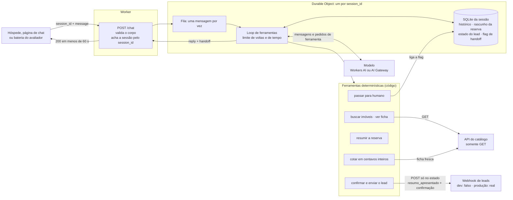
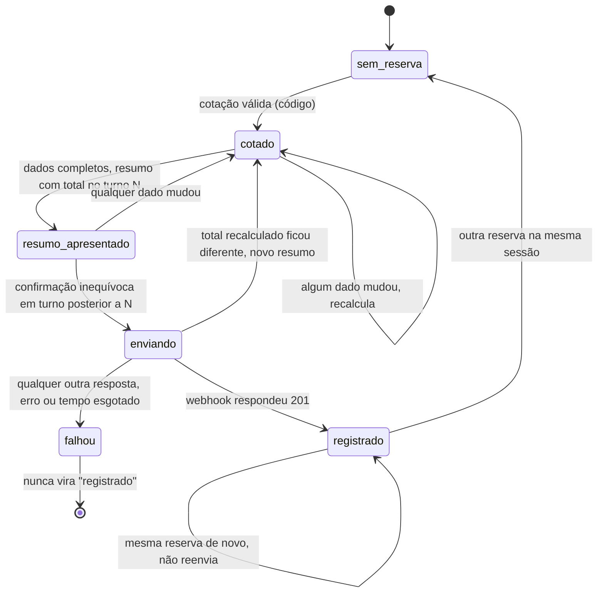

# Desenho do agente em produção (esboço)

Um agente só. Requisitos em [`docs/CONTRATO.md`](../CONTRATO.md). Os nomes de ferramenta
abaixo são ilustrativos; os definitivos saem da frente A.

## Caminho de uma mensagem

- A fila existe porque o Durable Object pode intercalar outro pedido enquanto espera o
  modelo ou o catálogo. Duas mensagens da mesma sessão nunca correm juntas.
- O texto que vem do catálogo entra na conversa como dado delimitado, nunca como instrução.
- O estado do envio é gravado antes do POST. Um reinício no meio não gera segundo envio.
- Em `dev` o webhook é um falso que replica o contrato do real. O real não recebe nenhum
  POST antes da entrega.

## Trava de confirmação

- Resumo e confirmação ficam em turnos diferentes: a ferramenta de envio recusa se o resumo
  não foi apresentado num turno anterior.
- No envio, o total é recalculado com a ficha lida de novo. O valor do webhook sai desse
  cálculo, não do texto da conversa.
- Um lead por reserva: a confirmação é consumida uma vez.
- O que acontece depois de `falhou` e como começa uma segunda reserva dependem de lacunas
  ainda abertas (L-11 e L-7); o desenho final segue o que ficar registrado em `DECISOES.md`.

## Código decide, modelo conversa

| Do código | Do modelo |
|---|---|
| Preço, em centavos inteiros | Entender o que o hóspede quer |
| Dia da semana e número de noites | Escolher qual ferramenta chamar e com quais dados |
| As recusas (mínimo, capacidade, datas) e o motivo | Redigir a resposta em linguagem natural |
| O texto do valor em reais (`R$ 2.156,00`) | Pedir o dado que falta |
| O valor enviado ao webhook | Reconhecer reclamação, desconto e negociação e chamar o handoff |
| Transições da trava de confirmação | |
| Validação de entrada e de dados do lead | |
| A flag `handoff` devolvida na resposta | |

O modelo nunca escreve um total por conta própria: ele recebe o texto pronto da ferramenta.
Não existe ferramenta que aceite desconto ou preço informado pelo hóspede.
