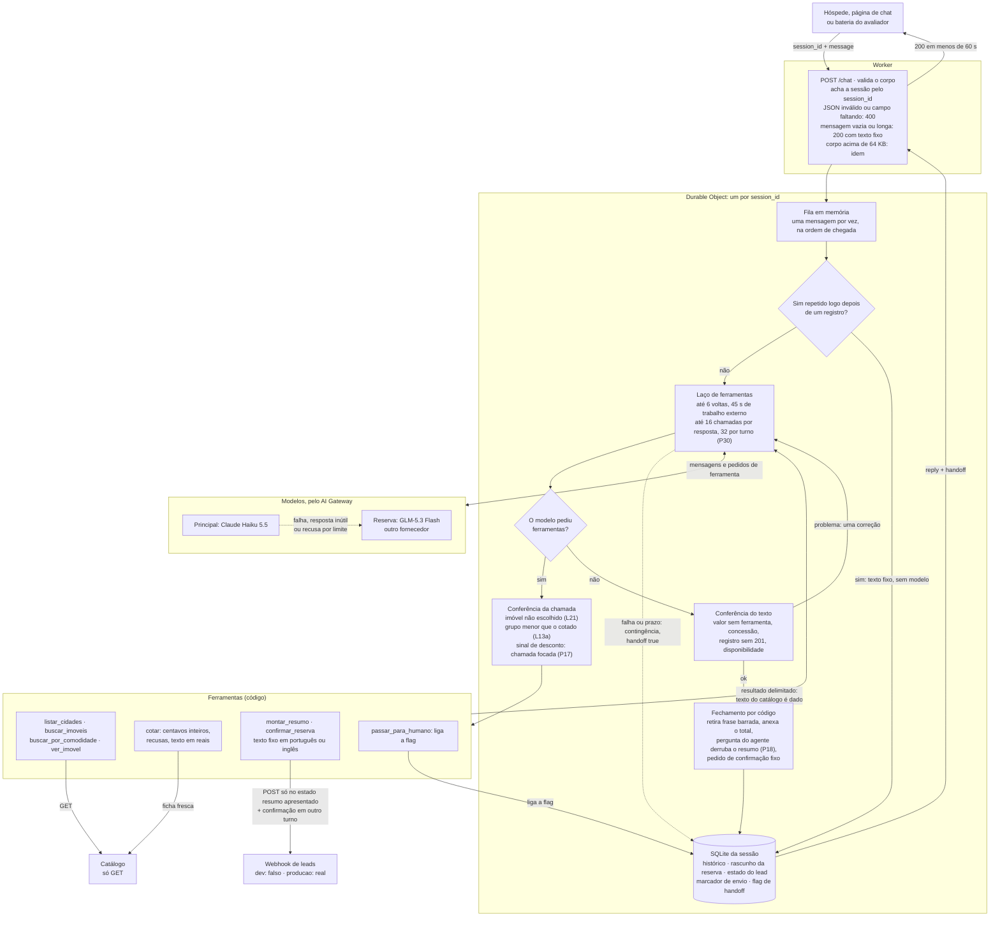
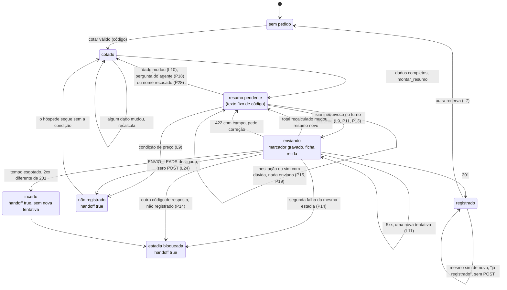

# Desenho do agente em produção

Um agente só. Requisitos em [`docs/CONTRATO.md`](../CONTRATO.md); decisões citadas (L, P,
X) em [`DECISOES.md`](../../DECISOES.md). Os desenhos descrevem a árvore final 9d37f9a,
com as frentes F (até a P35), G (com a correção do teto no caminho do lead), H, I e T, todas
verificadas. Os números do desenho foram conferidos contra o código dela: 6 voltas, 45 s de
trabalho externo, 16 chamadas por resposta e 32 por turno, 2 buscas por comodidade, janela
de 80 mensagens, 8.000 caracteres por mensagem e 64 KB de corpo.

## 1. Um turno: do pedido à resposta

Texto alternativo: o hóspede manda `session_id` e `message` ao Worker. O Worker valida o
corpo e entrega a mensagem ao Durable Object daquela sessão, que a põe numa fila de uma
mensagem por vez. O laço chama o modelo (o principal e, se ele falhar ou recusar por
limite, o reserva). Se o modelo pede ferramentas, o código confere a chamada, executa,
grava o resultado e volta ao modelo, até 6 voltas e com teto de chamadas (P30). Quando o modelo responde em texto, o
código confere o texto, pede uma correção se achar problema, retira o que não pode
chegar ao hóspede e acrescenta o total e o pedido de confirmação gerados por código. A
sessão grava histórico e estado e o Worker devolve `reply` e `handoff`. Qualquer falha
vira o aviso de contingência com `handoff: true`, nunca erro 500.

- A fila existe porque o objeto intercala outro pedido enquanto espera o modelo ou o
  catálogo, e o bloqueio nativo tem limite de 30 s (`docs/VERIFICACOES.md` §1).
- O texto que vem do catálogo entra na conversa como dado delimitado, nunca como instrução.
- O total sai pronto da ferramenta de cotação. A conferência retira do texto do modelo
  valor em reais que nenhuma ferramenta calculou (frente G, na `main`). Ela não cobre
  número por extenso, e o total repetido sem resumo aberto, depois que a cotação sai da
  janela de 80 mensagens, fica como limite conhecido (P26).
- Em `dev` o webhook é um falso que replica o contrato do real. O real não recebe nenhum
  POST antes da entrega.
- Recusa por limite de pedidos vai direto ao reserva e não é repetida (L18). Sem gateway
  configurado, o reserva responde direto (P16).
- O resumo para confirmação, o resultado da confirmação e o aviso de falha são textos
  fixos de código, em português ou em inglês (L15).

## 2. O lead: resumo, confirmação, envio e falha

Texto alternativo: com imóvel, datas, hóspedes, nome e telefone, o código monta o resumo
e o mostra num turno. No turno seguinte, só um sim inequívoco confirma; hesitação repete
o pedido; um sim com anúncio de dúvida ("sim, uma dúvida") não envia nada (P19); condição de preço passa para humano; qualquer dado mudado, uma pergunta do
próprio agente ou a recusa do nome (P28) derruba o resumo. Na confirmação, o código grava o marcador de envio,
relê a ficha e recalcula o total; se mudou, mostra um resumo novo. Com o envio desligado
não há POST. Resposta 201 é a única que vira "registrado". 5xx tem uma nova tentativa;
422 com campo apontado pede a correção; tempo esgotado ou resultado incerto não se
repete; qualquer outro código não registra, passa para humano e bloqueia a estadia já
na primeira vez. A segunda falha, de qualquer tipo, para a mesma estadia passa para humano e
bloqueia a estadia: no máximo 2 POSTs sem 201 por estadia.

- Resumo e confirmação ficam em turnos diferentes: a ferramenta de envio recusa se o resumo
  não foi apresentado num turno anterior. A confirmação não recebe argumentos: envia só o
  resumo gravado.
- Se o teto de chamadas (P30) corta um `cotar` ou um `montar_resumo` no turno em que o
  hóspede confirma, a confirmação daquele turno não roda; o hóspede confirma de novo.
- No envio, o total é recalculado com a ficha lida de novo. O valor do webhook sai desse
  cálculo, não do texto da conversa.
- Um lead por reserva: a confirmação é consumida uma vez.
- O marcador de envio é gravado antes do POST. Um reinício do objeto no meio não gera
  segundo envio; marcador sem resultado conta como incerto.
- Estadia bloqueada não gera novo POST, mesmo com outro nome, telefone ou número de
  hóspedes. Outra estadia segue o fluxo normal (P14).
- O agente só diz que registrou depois de um `201`; falha nunca vira "registrado". Lead
  registrado é pedido encaminhado, não reserva garantida.
- O que acontece depois de uma falha e como começa uma segunda reserva eram lacunas
  abertas no esboço; foram decididas: L11 e P14 para a falha, L7 para a segunda reserva.

## 3. Código decide, modelo conversa

| Do código | Do modelo |
|---|---|
| Preço, em centavos inteiros, com o acréscimo de sexta e sábado | Entender o que o hóspede quer |
| Datas relativas no fuso de São Paulo, dia da semana e noites; saída sem ano a mais de 90 noites não cota (P21) | Escolher a ferramenta e os argumentos |
| As recusas (mínimo, capacidade, datas) e o motivo | Redigir a resposta no idioma do hóspede |
| O texto em reais (`R$ 2.156,00`) e o valor do webhook | Pedir o dado que falta |
| Resumo, leitura do sim, transições do lead, teto de envios | Reconhecer reclamação, desconto e negociação e chamar o handoff |
| Conferência do texto do modelo antes de sair | |
| Validação do corpo do `POST /chat` e dos dados do lead | |
| Nome do lead só com palavras que o hóspede escreveu (P20) | Pedir o nome quando a ferramenta recusa |
| A flag `handoff` devolvida na resposta | |

O modelo nunca escreve um total por conta própria: ele recebe o texto pronto da ferramenta,
e a conferência retira o valor que nenhuma ferramenta calculou (com os limites da seção 1).
Não existe ferramenta que aceite desconto ou preço informado pelo hóspede.
