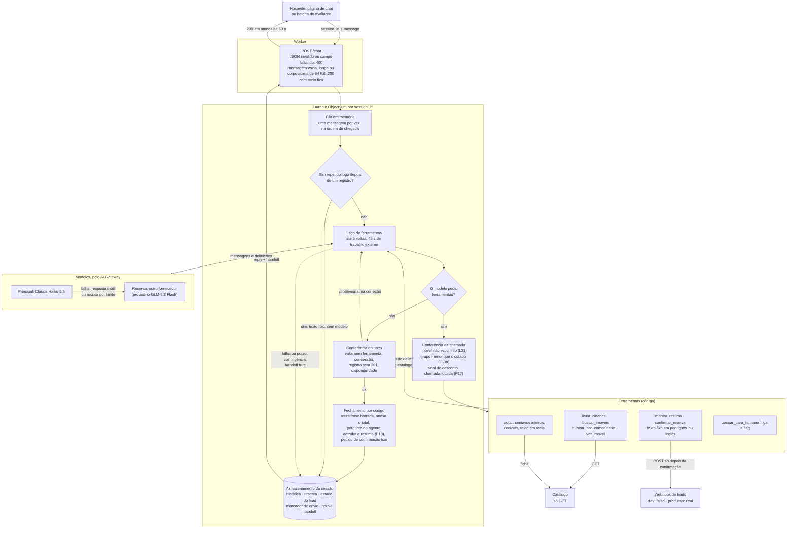
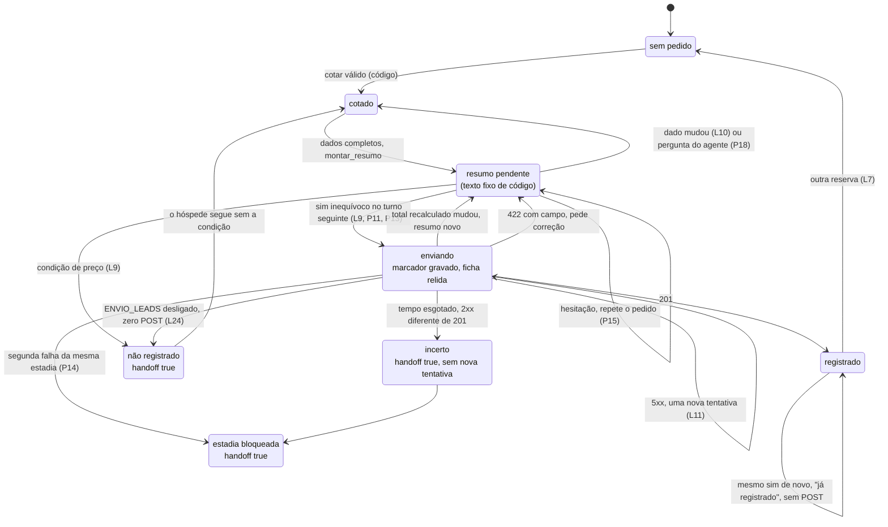

# Desenho do agente em produção

Um agente só. Requisitos em [`docs/CONTRATO.md`](../CONTRATO.md); decisões citadas (L, P,
X) em [`DECISOES.md`](../../DECISOES.md). Os desenhos descrevem o código da integração da
leva 2 (frentes F, G, H e I). Conferir contra a `main` final: a preencher.
<!-- PREENCHER: conferir os dois desenhos contra a main depois da entrada de F, G e H -->

## 1. Um turno: do pedido à resposta

Texto alternativo: o hóspede manda `session_id` e `message` ao Worker. O Worker valida o
corpo e entrega a mensagem ao Durable Object daquela sessão, que a põe numa fila de uma
mensagem por vez. O laço chama o modelo (o principal e, se ele falhar ou recusar por
limite, o reserva). Se o modelo pede ferramentas, o código confere a chamada, executa,
grava o resultado e volta ao modelo, até 6 voltas. Quando o modelo responde em texto, o
código confere o texto, pede uma correção se achar problema, retira o que não pode
chegar ao hóspede e acrescenta o total e o pedido de confirmação gerados por código. A
sessão grava histórico e estado e o Worker devolve `reply` e `handoff`. Qualquer falha
vira o aviso de contingência com `handoff: true`, nunca erro 500.

- A fila existe porque o objeto intercala outro pedido enquanto espera o modelo ou o
  catálogo, e o bloqueio nativo tem limite de 30 s (`docs/VERIFICACOES.md` §1).
- O modelo nunca escreve um total por conta própria: ele recebe o texto pronto da
  ferramenta, e a conferência retira valor em reais que nenhuma ferramenta calculou.
- Recusa por limite de pedidos vai direto ao reserva e não é repetida (L18). Sem gateway
  configurado, o reserva responde direto (P16).
- O resumo para confirmação, o resultado da confirmação e o aviso de falha são textos
  fixos de código, em português ou em inglês (L15).

## 2. O lead: resumo, confirmação, envio e falha

Texto alternativo: com imóvel, datas, hóspedes, nome e telefone, o código monta o resumo
e o mostra num turno. No turno seguinte, só um sim inequívoco confirma; hesitação repete
o pedido; condição de preço passa para humano; qualquer dado mudado, ou uma pergunta do
próprio agente, derruba o resumo. Na confirmação, o código grava o marcador de envio,
relê a ficha e recalcula o total; se mudou, mostra um resumo novo. Com o envio desligado
não há POST. Resposta 201 é a única que vira "registrado". 5xx tem uma nova tentativa;
422 com campo apontado pede a correção; tempo esgotado ou resultado incerto não se
repete. A segunda falha, de qualquer tipo, para a mesma estadia passa para humano e
bloqueia a estadia: no máximo 2 POSTs sem 201 por estadia.

- Resumo e confirmação ficam em turnos diferentes. A confirmação não recebe argumentos:
  envia só o resumo gravado.
- O marcador de envio é gravado antes do POST. Um reinício do objeto no meio não gera
  segundo envio; marcador sem resultado conta como incerto.
- Estadia bloqueada não gera novo POST, mesmo com outro nome, telefone ou número de
  hóspedes. Outra estadia segue o fluxo normal (P14).
- O agente só diz que registrou depois de um `201`. Lead registrado é pedido encaminhado,
  não reserva garantida.

## 3. Código decide, modelo conversa

| Do código | Do modelo |
|---|---|
| Preço, em centavos inteiros, com o acréscimo de sexta e sábado | Entender o que o hóspede quer |
| Datas relativas no fuso de São Paulo, dia da semana e noites | Escolher a ferramenta e os argumentos |
| As recusas (mínimo, capacidade, datas) e o motivo | Redigir a resposta no idioma do hóspede |
| O texto em reais (`R$ 2.156,00`) e o valor do webhook | Pedir o dado que falta |
| Resumo, leitura do sim, transições do lead, teto de envios | Reconhecer reclamação, desconto e negociação e chamar o handoff |
| Conferência do texto do modelo antes de sair | |
| Validação do corpo do `POST /chat` e dos dados do lead | |

Não existe ferramenta que aceite desconto ou preço informado pelo hóspede.
