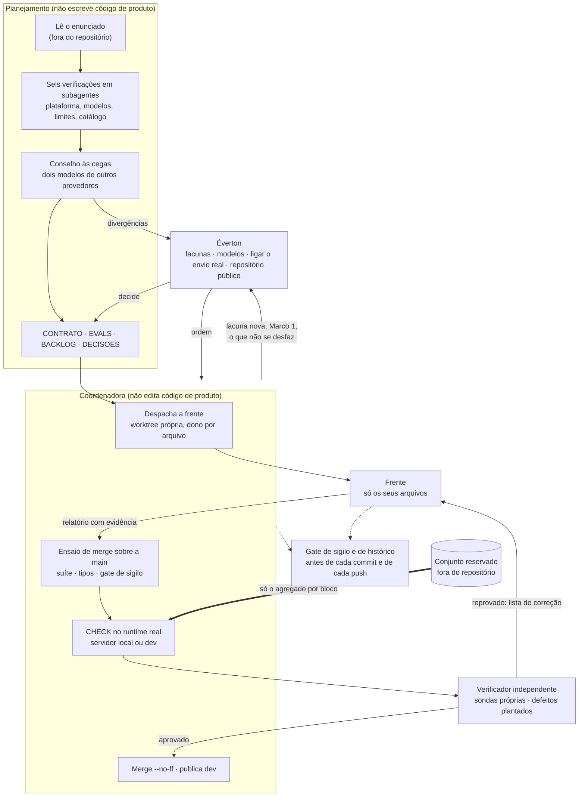
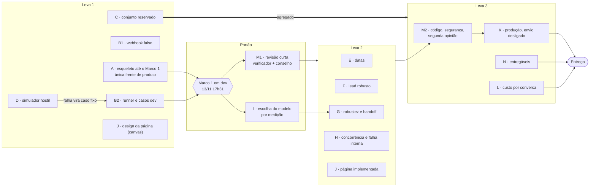
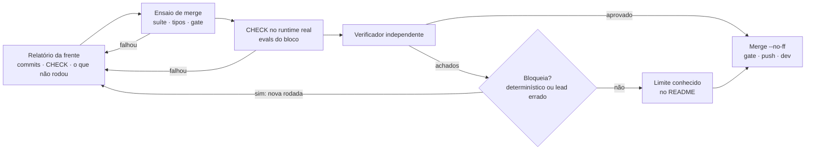

# Desenho da fábrica

Como o agente foi construído: quem decide, quem escreve, quem confere. O processo em texto
está em [`docs/COMO-FOI-FEITO.md`](../COMO-FOI-FEITO.md); o log completo, no
[backlog](../exploracoes/BACKLOG-CONCIERGE-2026-11.md).

## 1. Quem faz o quê

Texto alternativo: o Éverton decide as lacunas, os modelos e o que não se desfaz. A
sessão de planejamento leu o enunciado, verificou a plataforma, consultou dois modelos de
outros provedores às cegas e escreveu contrato, plano de evals e backlog. A coordenadora
despacha frentes em worktrees, confere cada entrega com ensaio de merge, suíte, gate e
CHECK no runtime real, pede um verificador independente e só então faz o merge. O
conjunto reservado fica fora do repositório e só devolve o agregado.

- **Barreira do reservado.** Quem escreveu o conjunto reservado (frente C, outro provedor)
  não corrige o agente, e quem corrige o agente só vê o agregado.
- **Falha do simulador vira caso fixo.** A conversa que falhou é reduzida e entra nos casos
  de desenvolvimento antes da correção.
- **Decisão provisória.** Lacuna nova com o Éverton fora segue a recomendação da
  coordenação, marcada como provisória (P1 a P18) até ele confirmar (X15).

## 2. Frentes e levas

Texto alternativo: na leva 1, a frente A é a única de produto até o Marco 1; em paralelo
correm as frentes de eval (webhook falso, runner e casos, conjunto reservado, simulador) e
o design da página. No portão ficam o Marco 1, a revisão curta M1 e a escolha do modelo.
A leva 2 tem as frentes de profundidade: datas, lead, robustez e handoff, concorrência e a
implementação da página. A leva 3 tem revisões, custo, produção e entregáveis; K, N, L e
parte da M2 foram adiantadas pela X24.

Provedores por frente (X6, X16, X23): coordenadora no Claude Fable 5.2; A e J no Fable;
F e G começaram no Fable e passaram ao Claude Opus 5.5; B2, D, E e H rodaram no Gemini 4
Hydrogen até a X23 e depois no Opus 5.5; C no GPT-6 Astra; B1 no DeepSeek; I, K, L, N e
todos os verificadores no Opus 5.5; segunda opinião da M2 no Gemini 4 Argon.

## 3. Ciclo de uma entrega até a `main`

Texto alternativo: a frente entrega um relatório. A coordenadora faz o ensaio de merge e
o CHECK no runtime real; falhou, volta para a frente. Passou, o verificador independente
ataca a entrega; reprovou, volta com a lista. Aprovado, merge sem reescrever histórico,
gate de sigilo, push e publicação em `dev`. Pela X24, só bloqueia a entrada o que é
determinístico ou gera lead errado; o resto vira limite conhecido no README.

Rodadas de verificador por frente e o que cada uma achou: tabela da seção 4 do
[`COMO-FOI-FEITO.md`](../COMO-FOI-FEITO.md).
