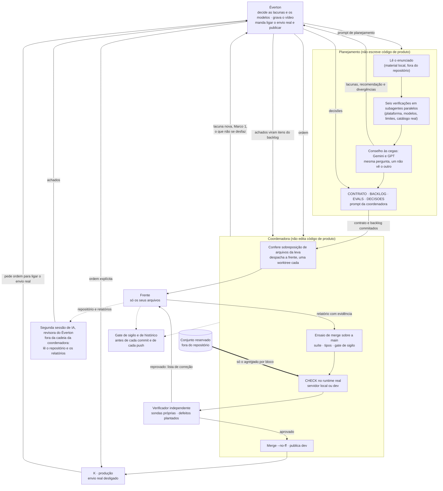
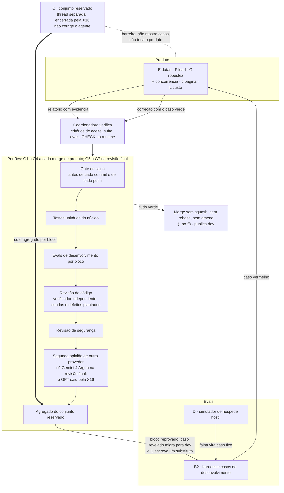
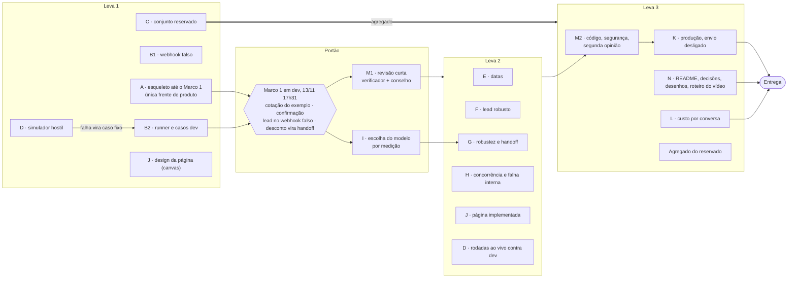
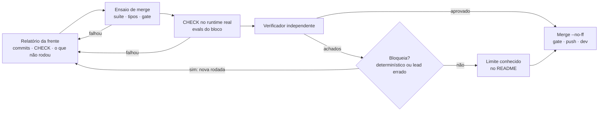

# Desenho da fábrica

Como o agente foi construído: quem decide, quem escreve, quem confere. O processo em texto
está em [`docs/COMO-FOI-FEITO.md`](../COMO-FOI-FEITO.md); o log completo, no
[backlog](../exploracoes/BACKLOG-CONCIERGE-2026-11.md).

## 1. Quem faz o quê

Texto alternativo: o Éverton decide as lacunas, os modelos e o que não se desfaz. A
sessão de planejamento leu o enunciado, verificou a plataforma, consultou dois modelos de
outros provedores às cegas e escreveu contrato, plano de evals e backlog. A coordenadora
despacha frentes em worktrees, confere cada entrega com ensaio de merge, suíte, gate e
CHECK no runtime real, pede um verificador independente e, por regra, só então faz o
merge (os merges que entraram sem verificador aprovado estão numa tabela do "Como foi
feito", seção 4). O
conjunto reservado ficou fora do repositório até a entrega de 14/11 e só devolve o agregado. Uma segunda sessão de
IA, revisora do Éverton e fora da cadeia da coordenadora, lê o repositório e os relatórios
e devolve os achados a ele, que viram itens do backlog. A frente K pede ao Éverton a ordem
para ligar o envio real de leads, e só ele a dá.

## Legenda

- **Éverton** decide tudo o que é produto (as lacunas do enunciado), grava o vídeo e é o
  único que manda ligar o envio real de leads e tornar o repositório público. Produção
  pode subir sem ele enquanto o envio real estiver desligado.
- **Sessão de planejamento** transforma o enunciado em contrato e backlog. Nenhuma outra
  sessão lê o enunciado: todas leem o contrato.
- **Conselho às cegas**: Gemini e GPT recebem a mesma pergunta de uma pasta vazia, sem ver a
  recomendação da sessão nem a resposta um do outro. Pergunta e respostas ficam em
  `docs/conselho/`. Foi assim no planejamento e no Marco 1, antes da X16; na revisão final
  (M2) a segunda opinião foi só do Gemini 4 Argon, porque o GPT saiu pela X16.
- **Sessão coordenadora** não edita código de produto. Ela só despacha, confere e mergeia;
  o contexto dela fica limpo para durar todas as levas.
- **Frentes** trabalham cada uma na sua worktree, com critérios de aceite binários e
  evidência exigida. Frente pequena é subagente; frente longa é thread própria.
- **Portões**: por regra, nada entra em `main` sem passar por eles. Os merges sem verificador
  aprovado estão na tabela da seção 4 do "Como foi feito", e a frente I publicou dois
  commits com o gate reprovando. M1 é a versão curta (revisão de
  código da máquina de estados no marco 1); M2 é a completa (código, segurança e segunda
  opinião do Gemini 4 Argon) antes de produção.
- **Laço de robustez**: falha do simulador → caso fixo em `evals/casos/dev/` → correção →
  agregado do reservado. Exceção: na árvore final, os quatro casos propostos pelo simulador
  não viraram caso fixo, porque fixariam expectativa errada (P36).
- **Barreira do reservado**: quem escreve o conjunto reservado não corrige o agente, e quem
  corrige o agente só vê o agregado. Exceção: os 4 casos revelados pela regra 6 de
  `docs/EVALS.md`, que saíram do conjunto e ganharam substitutos.
- **Sessão revisora do Éverton**: uma segunda sessão de IA, independente, que ele usa para
  revisar as entregas. Não recebe ordens da coordenadora e devolve os achados a ele.
- **Decisão provisória.** Lacuna aberta durante a execução é decidida pela coordenação como
  provisória (as decisões P), para o Éverton confirmar ou reverter (X15, X27 e X28). Ele
  confirmou todas em 14/11, menos a P23 (X33).

## 2. Portões e laços

Texto alternativo: os portões, na ordem: gate de sigilo, testes unitários, evals de
desenvolvimento, revisão de código pelo verificador independente, revisão de segurança,
segunda opinião de outro provedor e agregado do conjunto reservado. O laço de robustez
leva a falha do simulador a um caso fixo, que fica vermelho para a frente de produto até a
correção. Bloco reprovado no reservado revela o caso, que migra para os casos de
desenvolvimento, e a frente C escreve um substituto.

Os nós do desenho dão a regra. O gate de sigilo roda, por regra, antes de cada commit e de
cada push, e a frente I publicou dois commits com o gate reprovando; os merges que entraram
sem verificador aprovado estão na tabela da seção 4 do "Como foi feito".

## 3. Frentes e levas

Texto alternativo: na leva 1, a frente A é a única de produto até o Marco 1; em paralelo
correm as frentes de eval (webhook falso, runner e casos, conjunto reservado, simulador) e
o design da página. No portão ficam o Marco 1, a revisão curta M1 e a escolha do modelo.
A leva 2 tem as frentes de profundidade: datas, lead, robustez e handoff, concorrência e a
implementação da página. A leva 3 tem revisões, custo, produção e entregáveis; K, N, L e
parte da M2 foram adiantadas pela X24.

Linha de corte do plano: o acabamento da página (J) e o monitor diário (L) caem primeiro se
o tempo apertar; horas e corte estão no backlog.

Provedores por frente (X6, X16, X23): coordenadora no Claude Fable 5.2; A e J no Fable;
F e G começaram no Fable e passaram ao Claude Opus 5.5 (a F voltou ao Fable 5.2 de 13/11
23h28 a 14/11 02h55, por um desvio contra a X23 que a coordenação não percebeu); D e E rodaram no Gemini 4
Hydrogen e terminaram antes da X23; B2 e H rodaram no Gemini 4 Hydrogen até a X23 e depois
no Opus 5.5; C no GPT-6 Astra; B1 no DeepSeek; I, K, L, N e
todos os verificadores no Opus 5.5; S, T e os dois revisores do reservado no papel da
frente C (P33: o do diagnóstico e o segundo, com veto) também no Opus 5.5, com esforço alto; segunda opinião da M2 no Gemini 4 Argon.

## 4. Ciclo de uma entrega até a `main`

Texto alternativo: a frente entrega um relatório. A coordenadora faz o ensaio de merge e
o CHECK no runtime real; falhou, volta para a frente. Passou, o verificador independente
ataca a entrega; reprovou, volta com a lista. Aprovado, merge sem reescrever histórico,
gate de sigilo, push e publicação em `dev`. Pela X24, só bloqueia a entrada o que é
determinístico ou gera lead errado; o resto vira limite conhecido no README.

Rodadas de verificador por frente e o que cada uma achou: tabela da seção 4 do
[`COMO-FOI-FEITO.md`](../COMO-FOI-FEITO.md).
