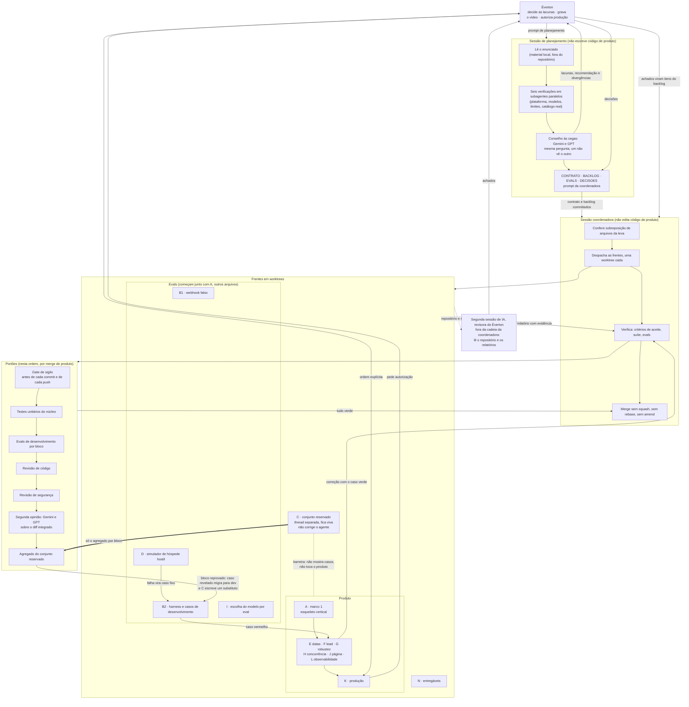

# Desenho da fábrica (esboço)

Como o agente foi construído: quem decide, quem escreve, quem confere. Requisitos em
[`docs/CONTRATO.md`](../CONTRATO.md); evals em [`docs/EVALS.md`](../EVALS.md).

## Quem faz o quê

## Legenda

- **Éverton** decide tudo o que é produto (as lacunas do enunciado), grava o vídeo e é o
  único que autoriza produção.
- **Sessão de planejamento** transforma o enunciado em contrato e backlog. Nenhuma outra
  sessão lê o enunciado: todas leem o contrato.
- **Conselho às cegas**: Gemini e GPT recebem a mesma pergunta de uma pasta vazia, sem ver a
  recomendação da sessão nem a resposta um do outro. Pergunta e respostas ficam em
  `docs/conselho/`.
- **Sessão coordenadora** não edita código de produto. Ela só despacha, confere e mergeia;
  o contexto dela fica limpo para durar todas as levas.
- **Frentes** trabalham cada uma na sua worktree, com critérios de aceite binários e
  evidência exigida. Frente pequena é subagente; frente longa é thread própria.
- **Portões**: nada entra em `main` sem passar por eles. M1 é a versão curta (revisão de
  código da máquina de estados no marco 1); M2 é a completa (código, segurança e segunda
  opinião de Gemini e GPT) antes de produção.
- **Laço de robustez**: falha do simulador → caso fixo em `evals/casos/dev/` → correção →
  agregado do reservado.
- **Barreira do reservado**: quem escreve o conjunto reservado não corrige o agente, e quem
  corrige o agente só vê o agregado.
- **Sessão revisora do Éverton**: uma segunda sessão de IA, independente, que ele usa para
  revisar as entregas. Não recebe ordens da coordenadora e devolve os achados a ele.

## Levas no tempo

Horas e linha de corte estão no backlog; aqui só a ordem.

```mermaid
flowchart LR
  subgraph L1["Leva 1 · até o marco 1"]
    direction TB
    L1A["A · única frente de produto"]
    L1B["B1 · B2 · C · D<br/>só evals, outros arquivos"]
  end
  M1{{"Marco 1 em dev<br/>cotação do exemplo · confirmação<br/>lead no webhook falso · desconto vira handoff<br/>+ M1 revisão curta"}}
  subgraph L2["Leva 2 · profundidade"]
    direction TB
    L2I["I · modelo escolhido por eval (primeiro)"]
    L2P["E · F · G · H em paralelo"]
    L2C["J · L (caem primeiro se apertar)"]
    L2D["D rodando contra dev"]
  end
  subgraph L3["Leva 3 · fechamento"]
    direction TB
    L3M["M2 · revisões e segunda opinião"]
    L3R["Agregado do reservado"]
    L3K["K · produção (com ordem do Éverton)"]
    L3N["N · README, decisões, desenhos, vídeo"]
  end
  L1 --> M1 --> L2 --> L3 --> ENT(["Entrega"])
```

